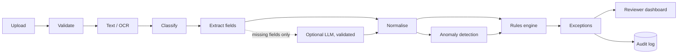
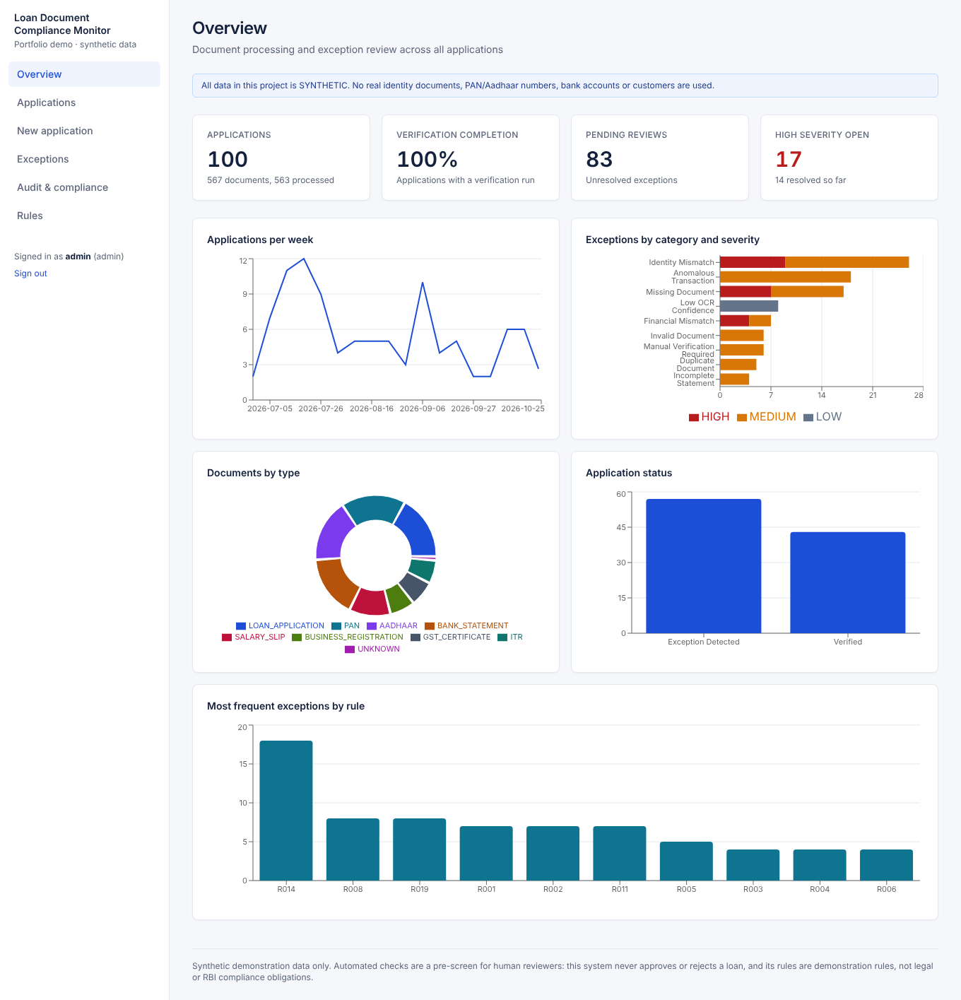
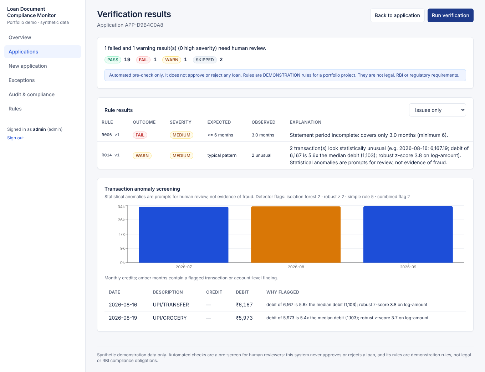
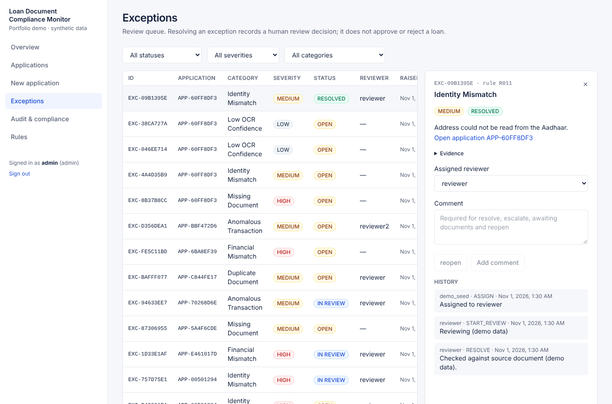
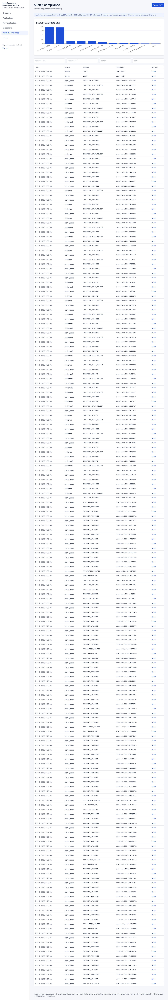

# AI-Powered Loan Document Verification & Compliance Monitor

A portfolio project that pre-checks **synthetic** loan application documents, finds inconsistencies and statistically unusual transactions, and routes exceptions to human reviewers with a full audit trail.

> **Read this first**
> * All data is synthetic and fictional. Do not upload real identity documents or personal financial records.
> * The system **never approves or rejects a loan**. It produces exceptions for a human reviewer.
> * Rules are **demonstration rules**, not legal, RBI or other regulatory requirements.
> * LLM output **never decides** whether a document or application is compliant. The LLM is optional and off by default.
> * The audit log is application-level append-only logging, **not** independently tamper-proof regulatory storage.
> * No production security certification is claimed.

## Business problem

Lenders receive bundles of KYC, income and bank documents. Checking names, addresses, salary figures and statement completeness by hand is slow and inconsistent, and unusual account activity is easy to miss. This project automates the first-pass checks so analysts spend their time on the exceptions.

## Features

* Upload PDF/PNG/JPEG with content-based validation, size limits, duplicate detection (SHA-256)
* Text extraction with PyMuPDF/pdfplumber, OCR fallback (Tesseract + OpenCV preprocessing) with confidence scores
* Document classification (PAN, Aadhaar, salary slip, bank statement, ITR, GST certificate, business registration, loan application)
* Field extraction with per-field confidence and page number; extracted vs human-verified values are distinguished
* Normalisation and fuzzy matching of names/addresses; PAN and GSTIN (checksum) validation
* 19 built-in demonstration rules plus admin-created rules; versioned, audited changes
* Anomaly detection: Isolation Forest + robust z-score + simple baseline, with a side-by-side comparison
* Exception workflow (open, in review, awaiting documents, escalated, resolved, reopened) with comments and assignment
* Append-only audit log with CSV export; 8 analytical SQL queries
* Optional LLM-assisted extraction/summary (Anthropic API) with strict validation and a deterministic fallback
* JWT auth with reviewer/admin roles; Swagger docs at `/docs`
* React dashboard: overview charts, applications, drag-and-drop upload, verification results, exception review, audit, rule management

## Architecture



More detail: [docs/architecture.md](docs/architecture.md), [docs/database_schema.md](docs/database_schema.md), [docs/validation_rules.md](docs/validation_rules.md).

## Tech stack

Python 3.11+ (developed on 3.13), FastAPI, Pydantic v2, SQLAlchemy 2, SQLite (PostgreSQL-compatible schema, see limitations), PyMuPDF, pdfplumber, Tesseract/pytesseract, OpenCV, Pillow, scikit-learn, pandas, RapidFuzz, ReportLab (synthetic documents), PyJWT, pytest. Frontend: React 18, TypeScript, Vite, Tailwind CSS 3, Recharts, Axios.

## Screenshots

Captured from the running app on synthetic data (`docs/screenshots/`):

| | |
|---|---|
|  |  |
|  |  |

## Setup

Prerequisites: Python 3.11+, Node.js 18+, and the Tesseract OCR binary (`apt install tesseract-ocr`, `brew install tesseract`, or the Windows installer from the UB Mannheim build; add it to `PATH`). Without Tesseract the app still runs; scanned images become processing exceptions.

### Linux / macOS

```bash
cd backend
python -m venv .venv && source .venv/bin/activate
pip install -r requirements-dev.txt
cd ..
cp .env.example .env              # edit SECRET_KEY
python scripts/generate_demo_data.py --reset --count 100   # ~1-2 minutes
cd backend && uvicorn app.main:app --reload --port 8000
```

### Windows (PowerShell)

```powershell
cd backend
py -m venv .venv; .\.venv\Scripts\Activate.ps1
pip install -r requirements-dev.txt
cd ..
Copy-Item .env.example .env       # edit SECRET_KEY
python scripts\generate_demo_data.py --reset --count 100
cd backend; uvicorn app.main:app --reload --port 8000
```

### Frontend (both)

```bash
cd frontend
npm install
npm run dev          # http://localhost:5173 (proxies /api to http://localhost:8000)
```

Production build: `npm run build` (output in `frontend/dist`).

API docs: http://localhost:8000/docs. Health check: `/api/health`.

### Demo users

Created on first start when the users table is empty (`SEED_DEMO_USERS=true`). Passwords come from `DEMO_ADMIN_PASSWORD` / `DEMO_REVIEWER_PASSWORD` (defaults in `.env.example`, **demo only, change them for anything shared**):

| User | Role |
|---|---|
| `admin` | admin (can change rules, resolve escalated exceptions) |
| `reviewer`, `reviewer2` | reviewer |

### Docker (untested)

`docker-compose.yml` and the two Dockerfiles are included, but **they were not built or run** while developing this project (no Docker daemon was available). Treat them as an untested starting point: `cp .env.example .env && docker compose up --build`, then open http://localhost:8080.

## Environment variables

See [.env.example](.env.example): `SECRET_KEY`, `DATABASE_URL`, `UPLOAD_DIR`, `MAX_UPLOAD_MB`, `CORS_ORIGINS`, `SEED_DEMO_USERS`, `DEMO_*_PASSWORD`, `OCR_ENABLED`, `ANTHROPIC_API_KEY` (optional), `LLM_MODEL`. A `.env` file in the project root is read automatically; real environment variables win.

## Demo data and evaluation

`scripts/generate_demo_data.py` creates 100 synthetic applications (about 70% salaried, 30% self-employed) with reportlab-generated PDFs, degraded scans and deliberately injected problems (missing documents, name/address/salary/income mismatches, typos, duplicates, short statements, corrupted files, prompt-injection text, invalid identifiers, anomalous transactions). Each application is tagged with a `scenario_label` that the rules engine never reads. Created-at timestamps are back-dated across ~120 days and some exceptions are assigned/resolved so the dashboard has something to show.

`python scripts/evaluate_detection.py` compares what the engine raised against the injected scenarios. Results from one run (seed 7; saved in `docs/evaluation_results.json`):

* Every injected scenario raised its expected rule in every application (e.g. 5/5 name mismatches, 4/4 salary mismatches, 3/3 corrupted PDFs); 4/4 name *typos* were correctly tolerated.
* **False alarms on clean applications: 2 of 32** (both R014 anomaly warnings on an unusually large debit that the generator made as ordinary spending). Some injected scenarios also raised extra, legitimate-looking rules (e.g. degraded scans trigger identity-field warnings because the text could not be read).
* Transaction-level detectors on injected one-off large credits (3 positives among ~10,000 transactions): all detectors found all three, but Isolation Forest alone flagged 319 transactions (precision ~1%), the simple ratio rule 583, robust z-score alone 8 (precision 38%), and the combined rule used by the app 10 (precision 30%). Collective anomalies (credit spikes, bursts) are caught by account-level checks and are evaluated at application level.

These numbers measure behaviour on **synthetic data generated by the same author as the detector**; they say little about real-world accuracy and must not be quoted as such.

## Tests

```bash
cd backend && pytest -q
```

75 tests pass (PDF extraction, OCR fallback, classification, field extraction, normalisation, cross-document checks, missing/duplicate documents, financial validation, exception workflow, DB constraints, audit immutability, API endpoints, reviewer/admin authorisation, corrupted/empty/injection edge cases, malformed LLM output via a mocked HTTP transport). The LLM path is tested **only against a mocked transport**; it has never been run against the real API in this project.

## API overview

| Area | Endpoints |
|---|---|
| Auth | `POST /api/auth/login`, `GET /api/auth/me` |
| Applications | `POST/GET /api/applications`, `GET /api/applications/{id}` |
| Documents | `POST /api/applications/{id}/documents`, `GET /api/documents/{id}`, `/extraction`, `/file`, `PUT /fields/{name}`, `POST /reject` |
| Verification | `POST /api/applications/{id}/verify`, `GET .../verification`, `.../exceptions`, `.../transactions` |
| Exceptions | `GET /api/exceptions`, `GET /{id}`, `PATCH /{id}/status`, `POST /{id}/comments`, `POST /{id}/assign` |
| Rules (admin writes) | `GET/POST /api/rules`, `PATCH /api/rules/{id}`, `GET /api/rules/{id}/history` |
| Analytics & audit | `/api/analytics/{overview,exceptions,document-processing,audit}`, `GET /api/audit`, `GET /api/audit/export.csv` |

## Known limitations

* **Synthetic layouts only.** Extraction is regex/label based and was built against the generator's own document layouts; real-world documents vary far more and would need layout-specific work.
* **OCR on scanned bank statements is weak** at the default resolution (a test statement scan recovered ~11% of rows); the demo keeps statements digital and scans only ID-type documents.
* Anomaly detection is statistical screening; it produces false positives and is not evidence of fraud. Evaluation uses labels from the same generator.
* Authentication is demo-grade (no MFA, refresh tokens, or persistent rate limiting). The audit log can be altered by a database administrator.
* **PostgreSQL has not been tested**; only SQLite has been run. The SQL analytics use portable constructs but are unverified on PostgreSQL.
* **Docker files are untested** (see above). The frontend has no automated component tests; it was checked with a TypeScript build and a scripted browser walkthrough.
* The LLM extraction/summary path is untested against the real API (mocked transport only).
* Reviewer workload and resolution times in the demo come from seeded actions, not real review activity.

## Future improvements

Layout-robust extraction (table models, templates per issuer), better scan quality handling, PostgreSQL CI run, write-once/external audit sink, real SSO/MFA, background job queue for processing, frontend component and end-to-end tests, richer anomaly features (counterparty graphs, seasonality), reviewer SLA tracking.
