# Architecture

```mermaid
flowchart LR
  U[Upload PDF / PNG / JPEG] --> V[File validation<br/>magic bytes, size, name sanitising]
  V --> D{Duplicate?<br/>SHA-256}
  D -- yes --> R5[Recorded as duplicate<br/>not re-processed]
  D -- no --> T[Text extraction<br/>PyMuPDF, pdfplumber rows,<br/>Tesseract+OpenCV fallback]
  T --> C[Classifier<br/>weighted keywords + filename]
  C --> X[Field extraction<br/>regex/labels, per-field confidence & page]
  X -.optional, missing fields only.-> L[LLM extraction<br/>Pydantic-validated, grounded]
  X --> N[Normalisation<br/>names, addresses, amounts, dates, IDs]
  L --> N
  N --> RE[Rules engine<br/>cross-document checks, versioned rules]
  N --> AD[Anomaly detection<br/>Isolation Forest + robust z + baseline]
  AD --> RE
  RE --> EX[Exception manager<br/>dedupe, severity, workflow]
  EX --> UI[Reviewer dashboard<br/>React]
  EX --> AU[(Append-only audit log)]
```

## Layers

| Layer | Location | Notes |
|---|---|---|
| API | `backend/app/routes`, `main.py`, `deps.py` | FastAPI; JWT bearer auth; role checks come from the DB, not the token; Swagger at `/docs` |
| Schemas | `backend/app/schemas/api.py` | Pydantic v2 request/response models with bounds and enums |
| Services | `backend/app/services` | Pure-ish business logic, framework independent, unit-tested |
| Persistence | `backend/app/models`, `database.py` | SQLAlchemy 2.x |
| Utilities | `backend/app/utils` | normalisation, file validation, security, synthetic data generator |
| Frontend | `frontend/src` | React 18 + TypeScript + Tailwind + Recharts + Axios + React Router |

## Security design

* **Untrusted content**: text inside documents is data, never instructions. A heuristic scanner flags instruction-like text (`R016`), skips the LLM for that document and routes it to a human. The LLM can only fill *missing* fields from a whitelist, values must be found verbatim in the source text, and its output is schema-validated; any failure falls back to the deterministic result.
* **LLM never decides compliance**: rule outcomes are computed from deterministic code only. Optional LLM narrative summaries are labelled as such.
* **No automated loan decision**: statuses are `Verified` / `Exception Detected` pre-check states; there is no approve/reject state anywhere.
* **Sensitive identifiers**: full 12-digit Aadhaar numbers are redacted before storage; the synthetic generator only emits masked identifiers (`XXXX XXXX 1234`) and GSTIN-valid fictional numbers.
* **Uploads**: type verified from file content (magic bytes), size-limited with a bounded read, filenames sanitised, stored under generated IDs.
* **Auth**: PBKDF2-HMAC-SHA256 password hashes, signed JWTs with expiry, in-memory login throttle, admin-only rule changes, audit events for logins and document views. Demo-grade only: no refresh tokens, MFA, or persistent rate limiting. **No production security certification is claimed.**
* **No hardcoded secrets**: `SECRET_KEY` and `ANTHROPIC_API_KEY` come from the environment; if `SECRET_KEY` is unset a random per-process key is used.
* **Errors** never echo document text or stack traces to clients.
* CSV audit exports neutralise spreadsheet formula injection.
