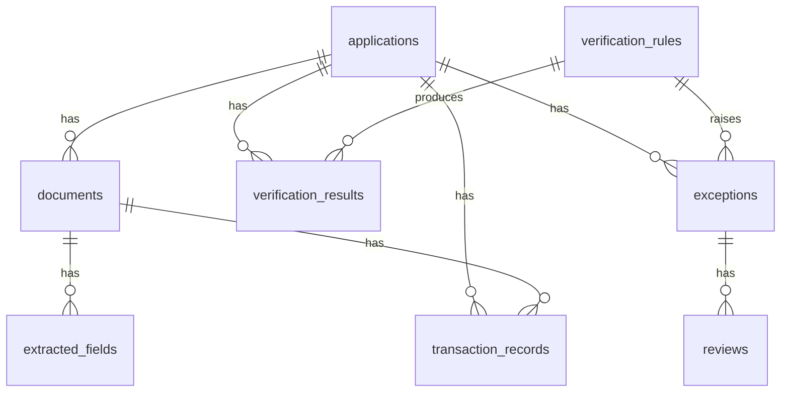

# Database schema

SQLAlchemy 2.x ORM with generic column types (`String`, `Float`, `JSON`, `DateTime`, ...). SQLite is the default; the schema is written to be PostgreSQL-compatible, but **it has only been run on SQLite** (set `DATABASE_URL` and install `psycopg2-binary` to try PostgreSQL). Foreign keys are enforced (`PRAGMA foreign_keys=ON` on SQLite). Timestamps are naive UTC.

| Table | Purpose | Notable columns |
|---|---|---|
| `users` | Demo reviewers/admins | `username` (unique), `password_hash` (PBKDF2-SHA256, salted), `role` |
| `applications` | Loan application record | `application_type`, `status`, `declared_monthly_income`, `scenario_label` (synthetic ground truth, evaluation only), `is_synthetic` |
| `documents` | Uploaded file metadata | `sha256`, `category`, `classification_confidence`, `text_method`, `ocr_confidence`, `processing_error`, `duplicate_of`, `extracted_text` (redacted) |
| `extracted_fields` | One row per field per document | `value` (NULL = not found, never invented), `confidence`, `page_number`, `method` (regex/table/llm/manual), `is_verified`, `verified_by`; unique `(document_id, field_name)` |
| `verification_rules` | Rule configuration | `kind`, `severity`, `enabled`, `params` (JSON), `version`, `is_demo_rule` |
| `verification_results` | Every rule outcome of every run | `run_id`, `rule_id`, `rule_version`, `outcome`, `expected`, `observed`, `explanation` |
| `exceptions` | Review queue items | `category`, `severity`, `status`, `assigned_reviewer`, `evidence` (JSON), `dedupe_key`; unique `(application_id, dedupe_key)` |
| `reviews` | Comments/assignments/status changes on an exception | `reviewer`, `action`, `comment` |
| `audit_logs` | Append-only event log | `event_id` (UUID), `actor`, `action`, `resource_type/id`, `previous_state`, `new_state`, `details` |
| `transaction_records` | Parsed bank-statement lines | `credit`, `debit`, `balance`, `anomaly_score`, `robust_z`, `is_anomalous`, `anomaly_reasons`, `injected_label` (synthetic truth) |
| `model_runs` | Anomaly/verification run metadata | `model_name`, `params`, `metrics`, `n_records` |

## Audit log immutability (and its limits)

* ORM `before_update` / `before_delete` listeners raise `AuditImmutableError`.
* On SQLite, `BEFORE UPDATE` / `BEFORE DELETE` triggers on `audit_logs` abort raw SQL changes too (covered by tests).
* **This is application-level append-only logging. It is not independently tamper-proof regulatory storage**: anyone with database administrator access can drop the triggers or edit the file. A real deployment would ship events to write-once storage or an external ledger.

## Analytical SQL

Eight named queries live in `backend/app/sql/analytics.sql` (joins, `GROUP BY`, `CASE`, CTE, `RANK`, `SUM() OVER`, `LAG`, `COALESCE`, `NULLIF`) and are executed through `services/analytics.py` with SQLAlchemy `text()`.
